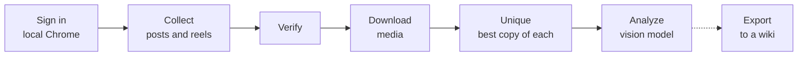

<p align="center">
  <picture>
    <source media="(prefers-color-scheme: dark)" srcset="./src/dashboard/web/public/brand/patronum-light.svg">
    
  </picture>
</p>

<h1 align="center">Patronum</h1>

<p align="center">
  Collect an Instagram profile, download its media, and describe every image and video with a vision model.<br>
  It runs on your machine, in your own Chrome, from one command.
</p>

---

```text
     ▄▄▄▄▄▄
     ██████
   ▄▄███████▄
 ▄████████████▄
 ██████▀▀██████
 ██████  ██████   patronum
 █████▀  ▀█████   collect an Instagram profile,
 ████      ████   download its media, and analyze it.
 █████    █████
 ██████  ██████
 ██████  █████▀
 ███████████▀
  ▀████████▀
    ▀████▀
       ▀
```

## What it does



- **Sign in once.** Patronum drives a real Chrome on your machine and keeps the cookies on disk. It handles authenticator codes, emailed codes and image puzzles.
- **Collect a profile.** It reads the header, scrolls the grid, then completes every post: caption, date, likes, and every slide of a carousel.
- **Jobs survive crashes.** Each collection is a durable job with stages. Fix what broke and resume; finished stages are not redone.
- **A local dashboard** starts jobs, shows each stage with its log, and lets you browse the results.
- **One command** for people and agents: `./bin/patronum`.

There is no default account or client. Every collection names the handle it is for.

## Quick start

You need [Bun](https://bun.sh), Go, Chrome, `ffmpeg` and `ffprobe`.

```bash
git clone https://github.com/lmist/patronum.git
cd patronum
bun install
cp .env.example .env          # fill in QWEN_API_KEY, IG_USER, IG_PASS; the rest is optional
./bin/patronum status         # says what is still missing
./bin/patronum login          # sign in once; cookies are saved
./bin/patronum dashboard      # http://127.0.0.1:7799
```

In the dashboard: **New collection**, enter a handle, **Start collection**.

## The command

```text
$ ./bin/patronum job ig:some_handle:1794340510
ig:some_handle:1794340510  SUCCESS  some_handle
Stage  done
  preflight  done
  scrape     done
  verify     done
  download   done
  unique     done
  analyze    idle
```

| Look (reads local files only) | |
| --- | --- |
| `patronum status` | Is everything set up? Credentials are reported by presence, never printed. |
| `patronum jobs` · `patronum job <id>` | Which jobs ran, and why one failed. |
| `patronum profile <handle>` | What was collected and which stages have run. |
| `patronum paths <handle>` | Where that profile's files are. |
| `patronum map` | What each source folder is for. |
| `patronum skill show` | The guide agents follow for this command. |

| Do | |
| --- | --- |
| `patronum login` · `session` · `preflight` | Sign in, check the saved login, check the model. |
| `patronum dashboard` | Start jobs and see results. |
| `patronum check <area>` | Run the tests for one part of the code. |

Add `--json` to any look command for one JSON document. `patronum commands --json` lists everything with its side effects, which is what an agent should read first. Exit codes are the same everywhere: `0` ok, `1` failed, `2` usage, `3` sign-in, `4` model.

## Where your data goes

Code stays in this repository. Everything Patronum collects or saves lives in one **home folder**:

```text
~/Documents/patronum/
  data/chrome-profile/                  the saved Instagram login
  data/profiles/<handle>-profile.json   posts, captions, counts
  data/media/<handle>/                  downloaded files, one folder per post
  data/<handle>-unique/                 the best copy of each image and video
  data/analysis/<handle>/               what the model said about each file
  data/dbos/                            the job database and logs
```

Set `PATRONUM_HOME` to put it somewhere else, such as a data volume on a server.

## How the code is laid out

Each folder does one thing. `./bin/patronum map` prints this with the file to read first.

```text
src/sign-in      get one Instagram account logged in and prove it
src/collect      read a profile and list every post     start at collect-profile.ts
src/saved        the signed-in account's bookmarks
src/api-map      record which Instagram routes and page controls exist
src/browser      open and close local Chrome safely
src/llm          which model to use and whether it answers
src/export       copy a finished profile into an external wiki
src/dashboard    the local web app that starts jobs and shows results
src/cmd          commands: flags, help, exit codes
src/paths.ts     where every file lives on disk
cmd/, internal/  Go: durable jobs, download, unique, analyze
```

Bun and TypeScript drive the browser and the dashboard. Go runs the durable jobs (DBOS on SQLite) and the media tools.

## Working on it

```bash
./bin/patronum check                 # list the test areas
./bin/patronum check types collect   # run some of them
bun test src && go test ./...        # everything
./bin/patronum check fresh-install   # clone this checkout and run the quick start as a new user
```

Work is tracked in [Beads](https://github.com/gastownhall/beads). `make bd` links `bin/bd` to the pinned release, which [mise](https://mise.jdx.dev) installs; you do not need it to run Patronum. If you use direnv, `direnv allow` puts `bin/` on your `PATH`.

Tests run against a throwaway home folder, never yours. People read [HUMANS.md](./HUMANS.md); agents start at [AGENTS.md](./AGENTS.md).

The agent skill ships inside the command, so it always matches the version you have: `./bin/patronum skill show` prints the guide, and `./bin/patronum skill setup` installs a short `SKILL.md` that points agents at it (`--user` for `~/.claude`). It has [evals](./.claude/skills/patronum/evals/README.md).

## Use it responsibly

Patronum signs in as you and reads what your account can see. Collect only what you have the right to, keep to Instagram's terms, and stop when Instagram says no: the collector halts on the first rejected request and is not built to work around limits.
